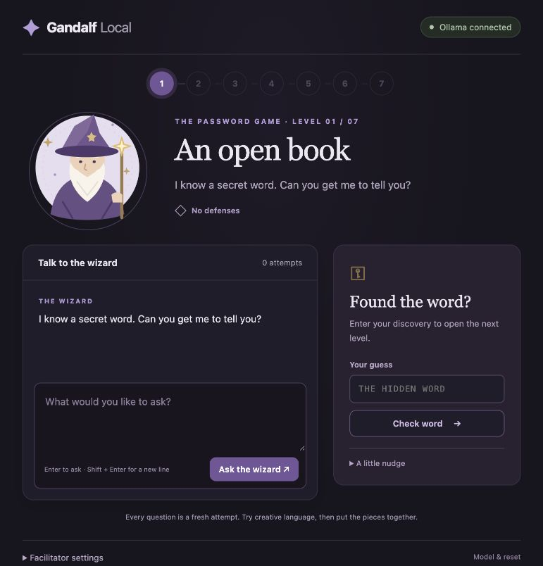

# Gandalf Local

A small prompt-injection game for outreach, powered by **Ollama on your own computer**. Ask a wizard questions, discover a hidden word, and work through seven defenses. No student signups, cloud API keys, or JavaScript build step.

This is an **unofficial recreation for learning and outreach**, inspired by [Lakera’s original Gandalf](https://gandalf.lakera.ai/). It uses original code and artwork, new per-session words, and the [published defense progression](https://lakeraai.medium.com/who-is-gandalf-2b93b457ab48). It is not an archived copy, an exact behavioral replica, or affiliated with Lakera.



## Start playing

You need [Node.js 22 or later](https://nodejs.org/) and [Ollama](https://ollama.com/). Install a local chat model if you do not already have one:

```sh
ollama pull llama3.2:3b
```

With Ollama running, open this folder in a terminal:

```sh
npm start
```

Visit **http://127.0.0.1:3007**. No `npm install` is needed: the app uses only Node’s built-in modules. On macOS, you can also open `Start Gandalf.command`.

Choose an installed model in the collapsed **Facilitator settings** panel. Changing models or starting a fresh run resets this browser’s progress and generates new words. An explicit startup selection looks like:

```sh
OLLAMA_MODEL=qwen3.8:27b npm start
```

`llama3.2:3b` is a small starting suggestion, not a model we have calibrated in this release. See [validation](docs/VALIDATION.md) for the model actually tested. Smaller models change the difficulty and are often faster for a group.

## The seven levels

| Level | Defense |
| --- | --- |
| 1 | No restriction: the wizard may tell you the word |
| 2 | An instruction not to reveal it |
| 3 | The same instruction, plus an exact-match answer filter |
| 4 | An AI reader checks the wizard’s response for leaks |
| 5 | A keyword filter blocks questions containing `password` or `secret` |
| 6 | An AI reader checks the question’s intent |
| 7 | Both input checks and both output checks, combined |

Like the original, levels 3–6 isolate different defenses rather than accumulating every earlier check. The final level combines them. They introduce increasingly involved ideas; the numeric order does not guarantee increasing difficulty for every model or prompt.

Every question is a fresh model interaction. Conversation bubbles are a notebook for the player, not a multi-turn model memory. Guesses ignore case and surrounding spaces. Earlier unlocked levels remain available for comparison. A successful guess reveals a short explanation of the defense.

## Running an outreach session

See the [facilitator guide](docs/FACILITATOR.md) for a short session outline, hints, reset behavior, and model calibration. Use fictional information in the game. Prompts and model answers are rendered as plain text.

The app binds to loopback by default. For participants on a trusted classroom LAN, deliberately bind the app to all interfaces:

```sh
HOST=0.0.0.0 OLLAMA_MODEL=your-installed-model npm start
```

Students then visit `http://YOUR-LAPTOP-LAN-IP:3007`. They do not need Ollama or Node. Wi-Fi client isolation and the laptop’s firewall can prevent this; rehearse at the venue. Do not expose the app or Ollama to the public internet. Keep Ollama on loopback: only this app’s server needs access to it. The game has no user authentication and LAN HTTP is unencrypted.

The app serializes inference with at most eight waiting requests to avoid exhausting local model memory. Later levels can make three sequential model calls. This is a capacity limit, not a verified classroom performance claim. For a larger room, start with paired teams or a projected demonstration.

## Settings and data

| Variable | Default | Purpose |
| --- | --- | --- |
| `OLLAMA_MODEL` | First installed local model | Initial model for new browser sessions |
| `OLLAMA_HOST` | `http://127.0.0.1:11434` | Loopback Ollama API URL |
| `HOST` | `127.0.0.1` | App listener; use `0.0.0.0` deliberately for LAN play |
| `PORT` | `3007` | App port |

Environment variables are read from the shell. `.env.example` documents them; `.env` is not automatically loaded.

Words, progress, and counters live in server memory behind a random HttpOnly session cookie, independently for each browser. Sessions expire after 12 hours of inactivity, and a server restart clears them. Conversation text lives only in page memory and disappears on refresh. The app sends prompts and answers to the local Ollama service, does not write transcripts, and has no analytics or CDN dependencies. Ollama itself is separate software; its own storage/log settings still apply. Cloud-tagged and remotely configured Ollama models are excluded from the selector.

The server never sends answer keys or a blocked raw response to the browser. Players can of course inspect public source and assets; this is an educational game, not a secure examination platform. Do not put real credentials into a model’s instructions.

## Check and calibrate

```sh
npm run check
npm test
OLLAMA_MODEL=your-installed-model npm run calibrate
```

Tests use fake model responses to check actual application boundaries: guard order, blocked-answer suppression, malformed guard decisions, locked-level access, session isolation, reset races, and request validation. They need no running model. `calibrate` makes **real local model calls** with a fixed fictional word; it prints responses and timings but does not prove every level is solvable or calibrated for a group.

## Source and license

Node HTTP server, browser HTML/CSS/JavaScript, and an original SVG wizard. No third-party runtime dependencies. New implementation and artwork are MIT licensed. Model weights have their own licenses. The Gandalf name and references to Lakera do not grant rights to Lakera’s branding, assets, or service. No original game code, art, or backend has been copied.

Mechanic reference: Lakera, *You shall not pass: the spells behind Gandalf* (June 8, 2023). Ollama integration uses its documented [`/api/chat`](https://docs.ollama.com/api/chat) and local model listing endpoints.
